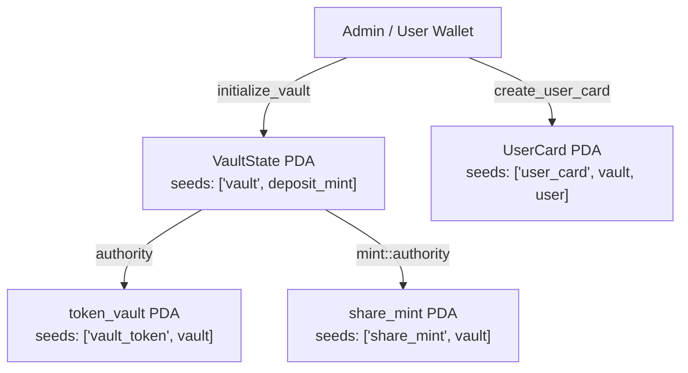

# Liquidity Vault — Сквозной проект курса Solana (Недели 8–13)

Полнофункциональное хранилище ликвидности (**Liquidity Vault**) на базе **Anchor 1.2.2 (Rust)** в сети **Solana Devnet** с интеграционными тестами на **LiteSVM** и Rust CLI-клиентом.

---

## 1. Быстрый старт (Сборка, тесты и CLI)

```bash
# Сборка SBF-бинарника программы
cargo build-sbf --manifest-path programs/liquidity-vault/Cargo.toml

# Запуск интеграционных тестов LiteSVM
cargo test -p liquidity-vault --test vault

# Неделя 8: инициализация хранилища, создание карточки и просмотр состояния
cargo run -p vault-client -- init --cluster devnet
cargo run -p vault-client -- card --cluster devnet
cargo run -p vault-client -- show --cluster devnet

# Неделя 9: депозит 1000 токенов
cargo run -p vault-client -- deposit --amount 1000 --cluster devnet

# Неделя 10: вывод 200 share-токенов
cargo run -p vault-client -- withdraw --shares 200 --cluster devnet

# Неделя 11: выпуск токена, создание пула Raydium CLMM и позиции кошелька
cargo run -p vault-client -- create-token --decimals 6 --supply 1000000 --cluster devnet
cargo run -p vault-client -- create-pool --price 1.0 --cluster devnet
cargo run -p vault-client -- open-position --amount-0 50000 --amount-1 50000 --cluster devnet
cargo run -p vault-client -- pool --cluster devnet
```

---

## 2. Сводная таблица адресов в Solana Devnet

| Сущность | Адрес в Solana Devnet | Ссылка в Solana Explorer |
|---|---|---|
| Программа `liquidity_vault` | `CFvWtQbdLxeJz55CfJLbpqyqFaUFsNZPuWMU7KcPgnE2` | [Explorer](https://explorer.solana.com/address/CFvWtQbdLxeJz55CfJLbpqyqFaUFsNZPuWMU7KcPgnE2?cluster=devnet) |
| Токен депозита `deposit_mint` (`token_mint_0`, 6 decimals) | `wKGeYnbJWf2iqakmqFkYGcnmWHQ2roJ6jJ1664Zf2oR` | [Explorer](https://explorer.solana.com/address/wKGeYnbJWf2iqakmqFkYGcnmWHQ2roJ6jJ1664Zf2oR?cluster=devnet) |
| Главный аккаунт `VaultState` PDA | `5vwYp3a9BaEHuduEY5fHikBvdgWpJJnVvviVDFtfToz6` | [Explorer](https://explorer.solana.com/address/5vwYp3a9BaEHuduEY5fHikBvdgWpJJnVvviVDFtfToz6?cluster=devnet) |
| Хранилище базового токена `token_vault` PDA | `87XEkicQVnwpeXZP53J75PVRGyCJBqkHMwuhsvvicHcM` | [Explorer](https://explorer.solana.com/address/87XEkicQVnwpeXZP53J75PVRGyCJBqkHMwuhsvvicHcM?cluster=devnet) |
| Минт долевых токенов `share_mint` PDA | `H5BNpYGoYAFaxvWofCXGsCddKMcUG6dcqVU2Q6v13WtP` | [Explorer](https://explorer.solana.com/address/H5BNpYGoYAFaxvWofCXGsCddKMcUG6dcqVU2Q6v13WtP?cluster=devnet) |
| Программа Raydium CLMM (Devnet) | `devi51mZmdwUJGU9hjN27vEz64Gps7uUefqxg27EAtH` | [Explorer](https://explorer.solana.com/address/devi51mZmdwUJGU9hjN27vEz64Gps7uUefqxg27EAtH?cluster=devnet) |
| Конфигурация пула `AmmConfig` (`tick_spacing = 60`, 0.25%) | `B9H7TR8PSjJT7nuW2tuPkFC63z7drtMZ4LoCtD7PrCN1` | [Explorer](https://explorer.solana.com/address/B9H7TR8PSjJT7nuW2tuPkFC63z7drtMZ4LoCtD7PrCN1?cluster=devnet) |
| Второй токен `secondary_mint` (`token_mint_1`, 6 decimals) | `EWXdK61y5MT8HfZypYJBLNj2A2paRAc5pXojcpeFkRwu` | [Explorer](https://explorer.solana.com/address/EWXdK61y5MT8HfZypYJBLNj2A2paRAc5pXojcpeFkRwu?cluster=devnet) |
| Пул Raydium CLMM `PoolState` PDA | `DKRQA3X9R6oneVnfgXEtCZdQmPRyASYV6rLXv7dBBD3n` | [Explorer](https://explorer.solana.com/address/DKRQA3X9R6oneVnfgXEtCZdQmPRyASYV6rLXv7dBBD3n?cluster=devnet) |
| Карточка пользователя `UserCard` PDA | `AGG4U9RRc41fXxBS9wjYh3tWpoZJxGEUnw87aZQ5x7WW` | [Explorer](https://explorer.solana.com/address/AGG4U9RRc41fXxBS9wjYh3tWpoZJxGEUnw87aZQ5x7WW?cluster=devnet) |

---

## 3. Неделя 8 — Каркас программы и карточки пользователей (PDA)

### Схема аккаунтов и PDA Seeds



### Транзакции Недели 8 в Solana Devnet
- **Деплой программы `liquidity_vault`**: [`4ZqotemkmCrHngZYCJzBKXoZBmgCCU9BU5dPoPFHJtZNV2pKnsGEGiZWjmvzbCSzQiu38mC65tdyXtQQ2jNbr861`](https://explorer.solana.com/tx/4ZqotemkmCrHngZYCJzBKXoZBmgCCU9BU5dPoPFHJtZNV2pKnsGEGiZWjmvzbCSzQiu38mC65tdyXtQQ2jNbr861?cluster=devnet)
- **Инициализация хранилища (`initialize_vault`)**: [`XQCpG81bjLAwqrhCf4T8GSna3eT9hXhWBkPxALgW5z78oSwpp4MKwsoaYqSEBer6PQs25P7uPHEh97u3jP3Pqwu`](https://explorer.solana.com/tx/XQCpG81bjLAwqrhCf4T8GSna3eT9hXhWBkPxALgW5z78oSwpp4MKwsoaYqSEBer6PQs25P7uPHEh97u3jP3Pqwu?cluster=devnet)
- **Создание карточки пользователя (`create_user_card`)**: [`3NDDdSVre3m4qVDzW6fzLSjGDv7V7Bx7HNCKwiSHbQmANnnubHhVQ3p5BC1ttv8zXBeqKnHwXP9gD8S5DUZ6pfQQ`](https://explorer.solana.com/tx/3NDDdSVre3m4qVDzW6fzLSjGDv7V7Bx7HNCKwiSHbQmANnnubHhVQ3p5BC1ttv8zXBeqKnHwXP9gD8S5DUZ6pfQQ?cluster=devnet)

---

## 4. Неделя 9 — Депозит и математика долей (Share Tokens)

### Формула расчёта долей
В модуле `programs/liquidity-vault/src/math.rs` реализована функция `calculate_shares_to_mint`:
- При пустом хранилище (`total_shares == 0` или `vault_balance == 0`) доли выпускаются `1:1`.
- При последующих депозитах расчёт выполняется в `u128` с округлением вниз (в пользу хранилища):
  $$\text{shares} = \left\lfloor \frac{\text{amount} \times \text{total\_shares}}{\text{vault\_balance}} \right\rfloor$$

### Транзакция Недели 9 в Solana Devnet
- **Депозит `1000.0` токенов (`deposit`)**: [`MByYftZVVVcxMiacMW5vjQMgLzhHT5CPMau1hULKzSnoFvmBYpG7hUTEd5bh7qb5QcFrpvqhWbr4nTYuJGApQKu`](https://explorer.solana.com/tx/MByYftZVVVcxMiacMW5vjQMgLzhHT5CPMau1hULKzSnoFvmBYpG7hUTEd5bh7qb5QcFrpvqhWbr4nTYuJGApQKu?cluster=devnet)

---

## 5. Неделя 10 — Вывод средств (Withdraw) и CPI с подписью PDA

### Схема подписей в CPI при выводе
1. **`token::burn`** — подписывается пользователем (`CpiContext::new`).
2. **`token::transfer_checked`** — подписывается от имени `VaultState` PDA (`CpiContext::new_with_signer`).
3. **Формула возврата**:
   $$\text{tokens\_out} = \left\lfloor \frac{\text{shares} \times \text{vault\_balance}}{\text{total\_shares}} \right\rfloor$$

### Транзакция Недели 10 в Solana Devnet
- **Вывод `200.0` share-токенов (`withdraw`)**: [`2N9YDXQ14WdpjpSUrrXLUyFnkE6PXZQVgD1H1tijQr2cA2zNqXQvjoWwcBbXbPUqa9GnDCDBsa9uh8kTeFVfaiFB`](https://explorer.solana.com/tx/2N9YDXQ14WdpjpSUrrXLUyFnkE6PXZQVgD1H1tijQr2cA2zNqXQvjoWwcBbXbPUqa9GnDCDBsa9uh8kTeFVfaiFB?cluster=devnet)

---

## 6. Неделя 11 — Пул Raydium CLMM и открытие позиции в диапазоне тиков

### Обоснование начальной цены и тикового диапазона
- Оба токена (`wKGeYnbJWf2iqakmqFkYGcnmWHQ2roJ6jJ1664Zf2oR` и `EWXdK61y5MT8HfZypYJBLNj2A2paRAc5pXojcpeFkRwu`) имеют `decimals = 6`.
- Начальная цена выбрана равной **$P = 1.0$** (`sqrt_price_x64 = 18446744073709551616`, `tick_current = 0`).
- Позиция открыта в симметричном диапазоне **`[-600, 600]`** ($\pm 10 \times \text{tick\_spacing}$, или примерно $\pm 6.18\%$ вокруг текущей цены).

### Транзакции Недели 11 в Solana Devnet
- **Выпуск `deposit_mint`**: [`xPsfmTckoHNbthKxcwtgRfW45CpM7zyBMZz9arToFPqETaXDcufi8NEcbiyEX27PwQpN2GDpFy1PMxeDsPjCHKa`](https://explorer.solana.com/tx/xPsfmTckoHNbthKxcwtgRfW45CpM7zyBMZz9arToFPqETaXDcufi8NEcbiyEX27PwQpN2GDpFy1PMxeDsPjCHKa?cluster=devnet)
- **Выпуск `secondary_mint`**: [`32biTkjtKowbN1nHpFmpnpkTce4FVSF3avJfVJvPP39PQhkJsyBJYe9ubYZ65ExPNXwVucT85FkJwVrG1ayA7sFL`](https://explorer.solana.com/tx/32biTkjtKowbN1nHpFmpnpkTce4FVSF3avJfVJvPP39PQhkJsyBJYe9ubYZ65ExPNXwVucT85FkJwVrG1ayA7sFL?cluster=devnet)
- **Создание пула Raydium CLMM (`create_pool`)**: [`3g8JzcHJev6jnXXYCpEczfvanSYVSMDF4oAnofUFhxCYFn5k87E4N1zYpuqPzh6ydGusrKQzzhHW96mqJTR672p3`](https://explorer.solana.com/tx/3g8JzcHJev6jnXXYCpEczfvanSYVSMDF4oAnofUFhxCYFn5k87E4N1zYpuqPzh6ydGusrKQzzhHW96mqJTR672p3?cluster=devnet)
- **Открытие CLMM-позиции кошелька `[-600 .. 600]`**: [`4Hue8jjso8ULKkxziEchiiEQYXGxNWbs6MFWbkhCaFtpjmgPRStJwLzF5bTamMp24iAvmTREZ5W8qFaEd4x1k58F`](https://explorer.solana.com/tx/4Hue8jjso8ULKkxziEchiiEQYXGxNWbs6MFWbkhCaFtpjmgPRStJwLzF5bTamMp24iAvmTREZ5W8qFaEd4x1k58F?cluster=devnet)
