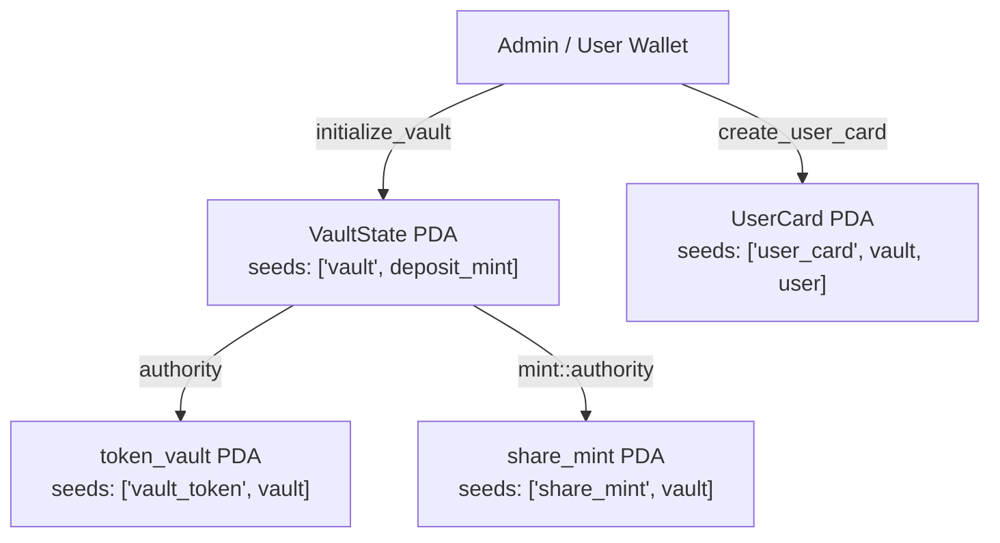

# Liquidity Vault — Сквозной проект курса Solana (Недели 8–13)

Полнофункциональное хранилище ликвидности (**Liquidity Vault**) на базе **Anchor 1.2.2 (Rust)**, интегрированное с концентрированным маркет-мейкером **Raydium CLMM** в сети **Solana Devnet** без использования TypeScript SDK для ончейн-операций, с модульными и интеграционными тестами на **LiteSVM** и веб-интерфейсом на **Next.js 15 + Solana Wallet Adapter**.

---

## Оглавление

1. [Структура репозитория](#1-структура-репозитория)
2. [Быстрый старт (Сборка, тесты, CLI и фронтенд)](#2-быстрый-старт-сборка-тесты-cli-и-фронтенд)
3. [Сводная таблица адресов в Solana Devnet](#3-сводная-таблица-адресов-в-solana-devnet)
4. [Неделя 8 — Каркас программы и карточки пользователей (PDA)](#4-неделя-8--каркас-программы-и-карточки-пользователей-pda)
5. [Неделя 9 — Депозит и математика долей (Share Tokens)](#5-неделя-9--депозит-и-математика-долей-share-tokens)
6. [Неделя 10 — Вывод средств (Withdraw) и CPI с подписью PDA](#6-неделя-10--вывод-средств-withdraw-и-cpi-с-подписью-pda)
7. [Неделя 11 — Пул Raydium CLMM и открытие позиции в диапазоне тиков](#7-неделя-11--пул-raydium-clmm-и-открытие-позиции-в-диапазоне-тиков)
8. [Неделя 12 — Стратегия и Swap хранилища через CPI в Raydium CLMM](#8-неделя-12--стратегия-и-swap-хранилища-через-cpi-в-raydium-clmm)
9. [Неделя 13 — Позиция Vault в Raydium CLMM, сбор комиссий, Impermanent Loss и ребалансировка](#9-неделя-13--позиция-vault-в-raydium-clmm-сбор-комиссий-impermanent-loss-и-ребалансировка)

---

## 1. Структура репозитория

```text
Liquidity Vault/
├── Anchor.toml                         # Конфигурация программы для localnet и devnet
├── Cargo.toml                          # Workspace: программа liquidity-vault и CLI vault-client
├── rust-toolchain.toml                 # Фиксация инструментария Rust
├── README.md                           # Документация проекта и ссылки на транзакции в Devnet
├── docs/
│   └── AI/
│       ├── README.md                   # Маршрутизатор архитектурных правил
│       └── scopes/vault.md             # Правила разработки программы, CPI и клиента
├── programs/
│   └── liquidity-vault/
│       ├── src/
│       │   ├── lib.rs                  # Точка входа программы и 9 инструкций
│       │   ├── state.rs                # Аккаунты VaultState, UserCard, Strategy и их PDA seeds
│       │   ├── error.rs                # Коды ошибок VaultError
│       │   ├── math.rs                 # Расчёт долей и вывода в u128 с округлением в пользу пула
│       │   ├── raydium.rs              # Ручной парсер PoolState/PersonalPosition и CPI в Raydium CLMM
│       │   └── instructions/           # Обработчики всех инструкций (недели 8–13)
│       └── tests/
│           └── vault.rs                # Интеграционные тесты LiteSVM (недели 8–13)
├── clients/
│   └── vault-client/
│       └── src/
│           ├── main.rs                 # CLI-команды для всех недель (init, card, deposit, withdraw, ...)
│           ├── rpc.rs                  # JSON-RPC, проверка genesis hash, simulateTransaction
│           ├── vault.rs                # Операции хранилища (недели 8–10)
│           ├── raydium.rs              # Математика Q64.64, тики и сборка инструкций Raydium CLMM
│           ├── pool.rs                 # Создание токенов, пула и позиции кошелька (неделя 11)
│           ├── strategy.rs             # Инициализация стратегии и CPI swap со slippage (неделя 12)
│           └── position.rs             # Открытие/сбор комиссий/закрытие/ребаланс позиции (неделя 13)
```

---

## 2. Быстрый старт (Сборка, тесты, CLI и фронтенд)

### Сборка SBF-программы и запуск тестов LiteSVM
```bash
# Сборка SBF-бинарника программы
cargo build-sbf --manifest-path programs/liquidity-vault/Cargo.toml

# Запуск всех интеграционных тестов LiteSVM (недели 8–13)
cargo test -p liquidity-vault --test vault
```

### Команды Rust-клиента (`vault-client`)
```bash
# Просмотр полного состояния хранилища, карточки пользователя и стратегии в Devnet
cargo run -p vault-client -- show --cluster devnet

# Просмотр состояния пула Raydium CLMM в Devnet
cargo run -p vault-client -- pool --cluster devnet

# Неделя 8: инициализация хранилища и создание карточки пользователя
cargo run -p vault-client -- init --cluster devnet
cargo run -p vault-client -- card --cluster devnet

# Неделя 9: депозит 1000 токенов
cargo run -p vault-client -- deposit --amount 1000 --cluster devnet

# Неделя 10: вывод 200 share-токенов
cargo run -p vault-client -- withdraw --shares 200 --cluster devnet

# Неделя 11: выпуск токена, создание пула Raydium CLMM и позиции кошелька
cargo run -p vault-client -- create-token --decimals 6 --supply 1000000 --cluster devnet
cargo run -p vault-client -- create-pool --price 1.0 --cluster devnet
cargo run -p vault-client -- open-position --amount-0 50000 --amount-1 50000 --cluster devnet

# Неделя 12: инициализация стратегии и обмен через CPI (успешный и отклонённый по slippage)
cargo run -p vault-client -- strategy --cluster devnet
cargo run -p vault-client -- vault-swap --amount 300 --a-to-b --slippage-bps 100 --cluster devnet
cargo run -p vault-client -- vault-swap --amount 50 --a-to-b --reject --cluster devnet

# Неделя 13: позиция Vault в CLMM, внешние свопы трейдеров, сбор комиссий, закрытие и ребалансировка
cargo run -p vault-client -- vault-open-position --amount-0 200 --amount-1 200 --cluster devnet
cargo run -p vault-client -- trader-swap --amount 5000 --zero-for-one --cluster devnet
cargo run -p vault-client -- vault-collect-fees --cluster devnet
cargo run -p vault-client -- vault-close-position --slippage-bps 100 --cluster devnet
cargo run -p vault-client -- vault-rebalance --amount-0 150 --amount-1 150 --cluster devnet
```

---

## 3. Сводная таблица адресов в Solana Devnet

| Сущность | Адрес в Solana Devnet | Ссылка в Solana Explorer |
|---|---|---|
| Программа `liquidity_vault` | `CFvWtQbdLxeJz55CfJLbpqyqFaUFsNZPuWMU7KcPgnE2` | [Explorer](https://explorer.solana.com/address/CFvWtQbdLxeJz55CfJLbpqyqFaUFsNZPuWMU7KcPgnE2?cluster=devnet) |
| Программа Raydium CLMM (Devnet) | `devi51mZmdwUJGU9hjN27vEz64Gps7uUefqxg27EAtH` | [Explorer](https://explorer.solana.com/address/devi51mZmdwUJGU9hjN27vEz64Gps7uUefqxg27EAtH?cluster=devnet) |
| Конфигурация пула `AmmConfig` (0.25%, `tick_spacing = 60`) | `B9H7TR8PSjJT7nuW2tuPkFC63z7drtMZ4LoCtD7PrCN1` | [Explorer](https://explorer.solana.com/address/B9H7TR8PSjJT7nuW2tuPkFC63z7drtMZ4LoCtD7PrCN1?cluster=devnet) |
| Токен депозита `deposit_mint` (`token_mint_0`, 6 decimals) | `wKGeYnbJWf2iqakmqFkYGcnmWHQ2roJ6jJ1664Zf2oR` | [Explorer](https://explorer.solana.com/address/wKGeYnbJWf2iqakmqFkYGcnmWHQ2roJ6jJ1664Zf2oR?cluster=devnet) |
| Второй токен `secondary_mint` (`token_mint_1`, 6 decimals) | `EWXdK61y5MT8HfZypYJBLNj2A2paRAc5pXojcpeFkRwu` | [Explorer](https://explorer.solana.com/address/EWXdK61y5MT8HfZypYJBLNj2A2paRAc5pXojcpeFkRwu?cluster=devnet) |
| Главный аккаунт `VaultState` PDA | `5vwYp3a9BaEHuduEY5fHikBvdgWpJJnVvviVDFtfToz6` | [Explorer](https://explorer.solana.com/address/5vwYp3a9BaEHuduEY5fHikBvdgWpJJnVvviVDFtfToz6?cluster=devnet) |
| Хранилище базового токена `token_vault` PDA | `87XEkicQVnwpeXZP53J75PVRGyCJBqkHMwuhsvvicHcM` | [Explorer](https://explorer.solana.com/address/87XEkicQVnwpeXZP53J75PVRGyCJBqkHMwuhsvvicHcM?cluster=devnet) |
| Минт долевых токенов `share_mint` PDA | `H5BNpYGoYAFaxvWofCXGsCddKMcUG6dcqVU2Q6v13WtP` | [Explorer](https://explorer.solana.com/address/H5BNpYGoYAFaxvWofCXGsCddKMcUG6dcqVU2Q6v13WtP?cluster=devnet) |
| Карточка пользователя `UserCard` PDA | `AGG4U9RRc41fXxBS9wjYh3tWpoZJxGEUnw87aZQ5x7WW` | [Explorer](https://explorer.solana.com/address/AGG4U9RRc41fXxBS9wjYh3tWpoZJxGEUnw87aZQ5x7WW?cluster=devnet) |
| Стратегия `Strategy` PDA | `9PdTskG24DE7AA1QbtHBpQ8Jt6ocaUTEo6v3RPucJnDB` | [Explorer](https://explorer.solana.com/address/9PdTskG24DE7AA1QbtHBpQ8Jt6ocaUTEo6v3RPucJnDB?cluster=devnet) |
| Второе хранилище `secondary_vault` PDA | `EghNHFQ3a7JRQTgdXJXyPUHCrdhNuQcdRUpcsLEZwb7H` | [Explorer](https://explorer.solana.com/address/EghNHFQ3a7JRQTgdXJXyPUHCrdhNuQcdRUpcsLEZwb7H?cluster=devnet) |
| Пул Raydium CLMM `PoolState` PDA | `DKRQA3X9R6oneVnfgXEtCZdQmPRyASYV6rLXv7dBBD3n` | [Explorer](https://explorer.solana.com/address/DKRQA3X9R6oneVnfgXEtCZdQmPRyASYV6rLXv7dBBD3n?cluster=devnet) |
| Активная CLMM-позиция хранилища `PersonalPosition` | `ESMAEb6FqBBWKa5zVTt12u1qfbMxeNDFkPiZfzBZD434` | [Explorer](https://explorer.solana.com/address/ESMAEb6FqBBWKa5zVTt12u1qfbMxeNDFkPiZfzBZD434?cluster=devnet) |

---

## 4. Неделя 8 — Каркас программы и карточки пользователей (PDA)

### Схема аккаунтов и PDA Seeds



- **`VaultState`** (`seeds = [b"vault", deposit_mint.key().as_ref()]`): хранит `admin`, `deposit_mint`, `share_mint`, `token_vault`, `total_deposited`, `total_shares` и канонические `bump`-значения.
- **`UserCard`** (`seeds = [b"user_card", vault.key().as_ref(), user.key().as_ref()]`): хранит персональную статистику вкладчика (`vault`, `owner`, `deposited_amount`, `shares_minted`, `bump`).

### Транзакции Недели 8 в Solana Devnet
- **Деплой программы `liquidity_vault`**: [`4ZqotemkmCrHngZYCJzBKXoZBmgCCU9BU5dPoPFHJtZNV2pKnsGEGiZWjmvzbCSzQiu38mC65tdyXtQQ2jNbr861`](https://explorer.solana.com/tx/4ZqotemkmCrHngZYCJzBKXoZBmgCCU9BU5dPoPFHJtZNV2pKnsGEGiZWjmvzbCSzQiu38mC65tdyXtQQ2jNbr861?cluster=devnet)
- **Инициализация хранилища (`initialize_vault`)**: [`XQCpG81bjLAwqrhCf4T8GSna3eT9hXhWBkPxALgW5z78oSwpp4MKwsoaYqSEBer6PQs25P7uPHEh97u3jP3Pqwu`](https://explorer.solana.com/tx/XQCpG81bjLAwqrhCf4T8GSna3eT9hXhWBkPxALgW5z78oSwpp4MKwsoaYqSEBer6PQs25P7uPHEh97u3jP3Pqwu?cluster=devnet)
- **Создание карточки пользователя (`create_user_card`)**: [`3NDDdSVre3m4qVDzW6fzLSjGDv7V7Bx7HNCKwiSHbQmANnnubHhVQ3p5BC1ttv8zXBeqKnHwXP9gD8S5DUZ6pfQQ`](https://explorer.solana.com/tx/3NDDdSVre3m4qVDzW6fzLSjGDv7V7Bx7HNCKwiSHbQmANnnubHhVQ3p5BC1ttv8zXBeqKnHwXP9gD8S5DUZ6pfQQ?cluster=devnet)

---

## 5. Неделя 9 — Депозит и математика долей (Share Tokens)

### Формула расчёта долей
В модуле `programs/liquidity-vault/src/math.rs` реализована функция `calculate_shares_to_mint`:
- Если хранилище пустое (`total_shares == 0` или `vault_balance == 0`), доли выпускаются `1:1`:
  $$\text{shares} = \text{amount}$$
- При последующих депозитах расчёт ведётся в `u128` с целочисленным делением вниз (в пользу хранилища):
  $$\text{shares} = \left\lfloor \frac{\text{amount} \times \text{total\_shares}}{\text{vault\_balance}} \right\rfloor$$
- Если из-за малого размера вклада $\text{shares} = 0$, возвращается ошибка `VaultError::ZeroSharesMinted`.

### Транзакция Недели 9 в Solana Devnet
- **Депозит `1000.0` токенов (`deposit`)**: [`MByYftZVVVcxMiacMW5vjQMgLzhHT5CPMau1hULKzSnoFvmBYpG7hUTEd5bh7qb5QcFrpvqhWbr4nTYuJGApQKu`](https://explorer.solana.com/tx/MByYftZVVVcxMiacMW5vjQMgLzhHT5CPMau1hULKzSnoFvmBYpG7hUTEd5bh7qb5QcFrpvqhWbr4nTYuJGApQKu?cluster=devnet)
  - Переведено в `token_vault`: `1000.0` (`1_000_000_000` raw)
  - Выпущено `share`-токенов через CPI `mint_to` с подписью `VaultState` PDA: `1000.0` (`1_000_000_000` raw)

---

## 6. Неделя 10 — Вывод средств (Withdraw) и CPI с подписью PDA

### Схема подписей в CPI при выводе
1. **Сжигание долей (`token::burn`)**:
   - Вызывается через `CpiContext::new`, так как владельцем `user_share_account` является сам пользователь (`user: Signer`), подписывающий внешнюю транзакцию.
2. **Возврат базовых токенов (`token::transfer_checked`)**:
   - Вызывается через `CpiContext::new_with_signer`, где от имени `VaultState` PDA передаются сиды `&[b"vault", deposit_mint.as_ref(), &[vault.bump]]`.
3. **Расчёт суммы к возврату (`calculate_tokens_to_withdraw`)**:
   $$\text{tokens\_out} = \left\lfloor \frac{\text{shares} \times \text{vault\_balance}}{\text{total\_shares}} \right\rfloor$$

### Транзакция Недели 10 в Solana Devnet
- **Вывод `200.0` share-токенов (`withdraw`)**: [`2N9YDXQ14WdpjpSUrrXLUyFnkE6PXZQVgD1H1tijQr2cA2zNqXQvjoWwcBbXbPUqa9GnDCDBsa9uh8kTeFVfaiFB`](https://explorer.solana.com/tx/2N9YDXQ14WdpjpSUrrXLUyFnkE6PXZQVgD1H1tijQr2cA2zNqXQvjoWwcBbXbPUqa9GnDCDBsa9uh8kTeFVfaiFB?cluster=devnet)
  - Сожжено долей: `200.0` (`200_000_000` raw)
  - Возвращено базовых токенов из `token_vault`: `200.0` (`200_000_000` raw)
  - Остаток в хранилище для работы стратегии: `800.0` токенов.

---

## 7. Неделя 11 — Пул Raydium CLMM и открытие позиции в диапазоне тиков

### Обоснование начальной цены и тикового диапазона
- Оба тестовых токена (`wKGeYnbJWf2iqakmqFkYGcnmWHQ2roJ6jJ1664Zf2oR` и `EWXdK61y5MT8HfZypYJBLNj2A2paRAc5pXojcpeFkRwu`) имеют `decimals = 6`.
- Начальная цена выбрана равной **$P = 1.0$** (`1.0 token_1` за `1.0 token_0`), что соответствует:
  $$\text{sqrt\_price\_x64} = 1 \times 2^{64} = 18\,446\,744\,073\,709\,551\,616, \quad \text{tick\_current} = 0$$
- Использован `AmmConfig` `B9H7TR8PSjJT7nuW2tuPkFC63z7drtMZ4LoCtD7PrCN1` с шагом сетки `tick_spacing = 60` (комиссия пула 0.25%).
- Первичная позиция провайдера ликвидности открыта в симметричном диапазоне **`[-600, 600]`** ($\pm 10 \times \text{tick\_spacing}$, или примерно $\pm 6.18\%$ вокруг цены $1.0$). Такой диапазон полностью помещается внутри центрального `TickArray` и обеспечивает достаточную глубину ликвидности ($L = 1\,658\,037\,490\,677$) для свопов стратегии хранилища.

### Транзакции Недели 11 в Solana Devnet
- **Выпуск `deposit_mint` (`token_mint_0`)**: [`xPsfmTckoHNbthKxcwtgRfW45CpM7zyBMZz9arToFPqETaXDcufi8NEcbiyEX27PwQpN2GDpFy1PMxeDsPjCHKa`](https://explorer.solana.com/tx/xPsfmTckoHNbthKxcwtgRfW45CpM7zyBMZz9arToFPqETaXDcufi8NEcbiyEX27PwQpN2GDpFy1PMxeDsPjCHKa?cluster=devnet)
- **Выпуск `secondary_mint` (`token_mint_1`)**: [`32biTkjtKowbN1nHpFmpnpkTce4FVSF3avJfVJvPP39PQhkJsyBJYe9ubYZ65ExPNXwVucT85FkJwVrG1ayA7sFL`](https://explorer.solana.com/tx/32biTkjtKowbN1nHpFmpnpkTce4FVSF3avJfVJvPP39PQhkJsyBJYe9ubYZ65ExPNXwVucT85FkJwVrG1ayA7sFL?cluster=devnet)
- **Создание пула Raydium CLMM (`create_pool`)**: [`3g8JzcHJev6jnXXYCpEczfvanSYVSMDF4oAnofUFhxCYFn5k87E4N1zYpuqPzh6ydGusrKQzzhHW96mqJTR672p3`](https://explorer.solana.com/tx/3g8JzcHJev6jnXXYCpEczfvanSYVSMDF4oAnofUFhxCYFn5k87E4N1zYpuqPzh6ydGusrKQzzhHW96mqJTR672p3?cluster=devnet)
- **Открытие CLMM-позиции кошелька в диапазоне `[-600 .. 600]`**: [`4Hue8jjso8ULKkxziEchiiEQYXGxNWbs6MFWbkhCaFtpjmgPRStJwLzF5bTamMp24iAvmTREZ5W8qFaEd4x1k58F`](https://explorer.solana.com/tx/4Hue8jjso8ULKkxziEchiiEQYXGxNWbs6MFWbkhCaFtpjmgPRStJwLzF5bTamMp24iAvmTREZ5W8qFaEd4x1k58F?cluster=devnet)

---

## 8. Неделя 12 — Стратегия и Swap хранилища через CPI в Raydium CLMM

### Механизм котировки и защиты от проскальзывания (`SlippageExceeded`)
1. Инструкция `init_strategy` создаёт PDA `Strategy` (`seeds = [b"strategy", vault.key().as_ref()]`) и второе хранилище `secondary_vault` (`seeds = [b"secondary_vault", vault.key().as_ref()]`), проверяя в `PoolState`, что пул действительно состоит из пары `(deposit_mint, secondary_mint)`.
2. Перед отправкой `swap` Rust-клиент выполняет RPC-симуляцию (`simulateTransaction`) с возвратом послесимуляционного состояния выходного хранилища, вычисляя точный ожидаемый выход `quoted_out`.
3. В инструкцию `swap` передаётся порог `min_amount_out = quoted_out * (10000 - slippage_bps) / 10000`. Программа вызывает `swap_v2` в Raydium CLMM с подписью `VaultState` PDA и сверяет фактический прирост выходного хранилища: если `received < min_amount_out`, возвращается `VaultError::SlippageExceeded` (`Custom(6022)`).

### Транзакции Недели 12 в Solana Devnet
- **Инициализация стратегии (`init_strategy`)**: [`GFBL41QtNTT3F1oCeVexwNohtB6gra3Z4eUbbRP9VgTL9faFL5LZFMqAMAySNg9spyPBtjUYuuBKCxC8VVHtftj`](https://explorer.solana.com/tx/GFBL41QtNTT3F1oCeVexwNohtB6gra3Z4eUbbRP9VgTL9faFL5LZFMqAMAySNg9spyPBtjUYuuBKCxC8VVHtftj?cluster=devnet)
- **Успешный CPI Swap (`300.0` Deposit Mint → `299.195999` Secondary Mint)**: [`2nSvsvwMxqeGzwQvmVUHzxjUDvG5oRaWCMYAxMztxCR2T6wkTdvbutjrgG9jzKvt1Esx1nhyMdZj9AZAPwjDhPKW`](https://explorer.solana.com/tx/2nSvsvwMxqeGzwQvmVUHzxjUDvG5oRaWCMYAxMztxCR2T6wkTdvbutjrgG9jzKvt1Esx1nhyMdZj9AZAPwjDhPKW?cluster=devnet)
  - Сдвиг цены в пуле: `tick_current: 0 → -4`, цена `1.000000 → 0.999639`
- **Отклонённая ончейн-транзакция по защите от проскальзывания (`Custom(6022) = SlippageExceeded`)**: [`3iWWxz1PiuLi8aifVdvyEEpvH9w5hvoxUZ7YGzgdXjxuvr6vxkFN42pqWmntzcAVrVqQx8rJGACwJyPgfEWvuzn1`](https://explorer.solana.com/tx/3iWWxz1PiuLi8aifVdvyEEpvH9w5hvoxUZ7YGzgdXjxuvr6vxkFN42pqWmntzcAVrVqQx8rJGACwJyPgfEWvuzn1?cluster=devnet)

---

## 9. Неделя 13 — Позиция Vault в Raydium CLMM, сбор комиссий, Impermanent Loss и ребалансировка

### Полный жизненный цикл CLMM-позиции хранилища
1. **Открытие позиции (`open_position`)**:
   - Vault размещает средства из `token_vault` и `secondary_vault` в диапазон тиков `[-360 .. 240]` вокруг текущей цены пула (`tick_current = -4`).
   - Владельцем Token-2022 NFT позиции (`position_nft_owner`) становится `VaultState` PDA.
2. **Генерация комиссий и их сбор (`collect_fees`)**:
   - Внешний трейдер совершает свопы в пуле (`5000.0 token_0 → token_1` и обратно `5000.0 token_1 → token_0`), генерируя комиссионный доход для всех активных позиций в диапазоне.
   - Вызов `collect_fees` (CPI `decrease_liquidity_v2(liquidity = 0)` с подписью `VaultState` PDA) переводит накопленные комиссии (`+0.069826` Deposit Mint и `+0.069826` Secondary Mint) непосредственно в хранилища `token_vault` и `secondary_vault`.
3. **Закрытие позиции (`close_position`) и анализ Impermanent Loss**:
   - При первом открытии позиции в диапазон `[-360 .. 240]` было внесено `134.400981` токена A и `196.000000` токена B (суммарно `330.400981` у.е.). После серии свопов и закрытия позиции в хранилище вернулось `134.290214` токена A и `196.110727` токена B + собранные комиссии по `0.069826` каждого токена (суммарно `330.540593` у.е.), то есть комиссионный доход полностью перекрыл микроскопический Impermanent Loss.
   - Во втором цикле внешний своп на `8000.0 token_0` сдвинул тик с `-4` до `-99` (цена упала с `0.999659` до `0.990155`). При закрытии позиции `[-360 .. 240]` доля дешевеющего `token_0` выросла с `100.660794` до `140.589714`, а доля дорожающего `token_1` снизилась со `147.0` до `107.358354` — наглядная иллюстрация **Impermanent Loss** при одностороннем движении цены.
4. **Ребалансировка (`vault-rebalance`)**:
   - Команда `vault-rebalance` закрыла старую позицию `[-360 .. 240]` и открыла новую позицию в смещённом диапазоне **`[-420 .. 180]`**, отцентрированном вокруг нового тика `-99`.

### Транзакции Недели 13 в Solana Devnet
- **Открытие первой CLMM-позиции Vault (`[-360 .. 240]`, `L = 11100016214`)**: [`3nNMfSwm2SKrxdG6jwekJRRbEx9NgQvJEGJekqysme1nAqTatNjrDu8dd4xnHx5EEtNSrU5qWG6WSy39MqQuNQuM`](https://explorer.solana.com/tx/3nNMfSwm2SKrxdG6jwekJRRbEx9NgQvJEGJekqysme1nAqTatNjrDu8dd4xnHx5EEtNSrU5qWG6WSy39MqQuNQuM?cluster=devnet)
- **Внешний своп трейдера #1 (`5000.0 token_0 → token_1`, тик `-4 → -64`)**: [`43s2qygth1at5UMmgJmqe8fKvNUW9rr2NzDyxAh7yihoznwBmvKjBYU4RhNvbLjQB5rzq7WkwaMZNHQ3B9oCt3rw`](https://explorer.solana.com/tx/43s2qygth1at5UMmgJmqe8fKvNUW9rr2NzDyxAh7yihoznwBmvKjBYU4RhNvbLjQB5rzq7WkwaMZNHQ3B9oCt3rw?cluster=devnet)
- **Внешний своп трейдера #2 (`5000.0 token_1 → token_0`, тик `-64 → -4`)**: [`3fEoZyLt9oLznRd1ygtvqfaiE6s4siuNumCpnpVq3oJkh9cqjGE4szEeLHChcVt5stUxQqCgKA8JSmH2c6NgfFkR`](https://explorer.solana.com/tx/3fEoZyLt9oLznRd1ygtvqfaiE6s4siuNumCpnpVq3oJkh9cqjGE4szEeLHChcVt5stUxQqCgKA8JSmH2c6NgfFkR?cluster=devnet)
- **Сбор комиссий хранилищем (`collect_fees` CPI)**: [`3LQZo8zCz6Kx2vULcjo8pGjmAqgmbzJfbecgSKTQvsuzDEPzq8ZJ4BumZSYGfh26CYPGJTdbxDmBWZirTkdRXsGc`](https://explorer.solana.com/tx/3LQZo8zCz6Kx2vULcjo8pGjmAqgmbzJfbecgSKTQvsuzDEPzq8ZJ4BumZSYGfh26CYPGJTdbxDmBWZirTkdRXsGc?cluster=devnet)
- **Закрытие первой позиции хранилищем (`close_position` CPI)**: [`4aNp9PqZ9fXi6uvh2qqjDuk28XogMhafQouZ49cUKcTzy7aKos4orBUmi3qHmrR4HQYxycgfUXop1iaoTGYe2fqq`](https://explorer.solana.com/tx/4aNp9PqZ9fXi6uvh2qqjDuk28XogMhafQouZ49cUKcTzy7aKos4orBUmi3qHmrR4HQYxycgfUXop1iaoTGYe2fqq?cluster=devnet)
- **Открытие позиции перед ребалансировкой (`[-360 .. 240]`)**: [`kzd9BnRsvDhnqjTn29ZpeNHUXfLFeekSngBRjD4NXUr5MpygmtAitZ2BDQrbSvCyqhNW9vhAuSGvAZcunCv4cUV`](https://explorer.solana.com/tx/kzd9BnRsvDhnqjTn29ZpeNHUXfLFeekSngBRjD4NXUr5MpygmtAitZ2BDQrbSvCyqhNW9vhAuSGvAZcunCv4cUV?cluster=devnet)
- **Своп трейдера для сдвига цены (`8000.0 token_0 → token_1`, тик `-4 → -99`)**: [`4kTYGKXaWpK9ESi9tHu4rEWRegwQvp5VLBYnVGx6TuR7UwjKX6U93UexarLnXr8zVWZnaVb5fQ63n6yYj73XxALx`](https://explorer.solana.com/tx/4kTYGKXaWpK9ESi9tHu4rEWRegwQvp5VLBYnVGx6TuR7UwjKX6U93UexarLnXr8zVWZnaVb5fQ63n6yYj73XxALx?cluster=devnet)
- **Ребалансировка — Шаг 1 (Закрытие старой позиции `[-360 .. 240]`)**: [`4jcQBHWTEmncxCggVvahguXgqxLk3JBnK9VszeGdKRY3ZXy1kd3jXibcpeZTUaknzuCucqCtKmfUvmw9jtnhnund`](https://explorer.solana.com/tx/4jcQBHWTEmncxCggVvahguXgqxLk3JBnK9VszeGdKRY3ZXy1kd3jXibcpeZTUaknzuCucqCtKmfUvmw9jtnhnund?cluster=devnet)
- **Ребалансировка — Шаг 2 (Открытие новой позиции `[-420 .. 180]`)**: [`2qsFSaiK2TX2auzhhNm7FuAnNYMmxtPCFfuv5EQvbQ9BtQmqmufVy1xZuNgKw5t9RTRUkMsfG59dBRMHyBP31EkN`](https://explorer.solana.com/tx/2qsFSaiK2TX2auzhhNm7FuAnNYMmxtPCFfuv5EQvbQ9BtQmqmufVy1xZuNgKw5t9RTRUkMsfG59dBRMHyBP31EkN?cluster=devnet)

