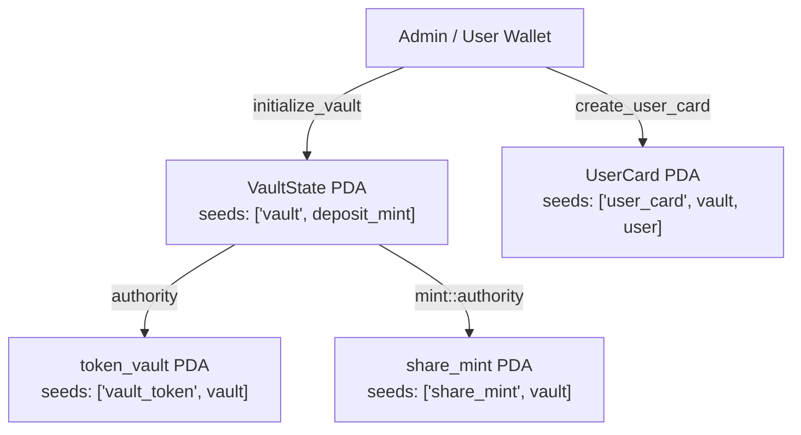

# Liquidity Vault — Сквозной проект курса Solana (Недели 8–13)

Полнофункциональное хранилище ликвидности (**Liquidity Vault**) на базе **Anchor 1.2.2 (Rust)** в сети **Solana Devnet** с интеграционными тестами на **LiteSVM** и Rust CLI-клиентом.

---

## 1. Быстрый старт (Сборка, тесты и CLI)

```bash
# Сборка SBF-бинарника программы
cargo build-sbf --manifest-path programs/liquidity-vault/Cargo.toml

# Запуск интеграционных тестов LiteSVM
cargo test -p liquidity-vault --test vault

# Неделя 8: инициализация хранилища, создание карточки и просмотр состояния
cargo run -p vault-client -- init --cluster devnet
cargo run -p vault-client -- card --cluster devnet
cargo run -p vault-client -- show --cluster devnet
```

---

## 2. Сводная таблица адресов в Solana Devnet

| Сущность | Адрес в Solana Devnet | Ссылка в Solana Explorer |
|---|---|---|
| Программа `liquidity_vault` | `CFvWtQbdLxeJz55CfJLbpqyqFaUFsNZPuWMU7KcPgnE2` | [Explorer](https://explorer.solana.com/address/CFvWtQbdLxeJz55CfJLbpqyqFaUFsNZPuWMU7KcPgnE2?cluster=devnet) |
| Токен депозита `deposit_mint` (`token_mint_0`, 6 decimals) | `wKGeYnbJWf2iqakmqFkYGcnmWHQ2roJ6jJ1664Zf2oR` | [Explorer](https://explorer.solana.com/address/wKGeYnbJWf2iqakmqFkYGcnmWHQ2roJ6jJ1664Zf2oR?cluster=devnet) |
| Главный аккаунт `VaultState` PDA | `5vwYp3a9BaEHuduEY5fHikBvdgWpJJnVvviVDFtfToz6` | [Explorer](https://explorer.solana.com/address/5vwYp3a9BaEHuduEY5fHikBvdgWpJJnVvviVDFtfToz6?cluster=devnet) |
| Хранилище базового токена `token_vault` PDA | `87XEkicQVnwpeXZP53J75PVRGyCJBqkHMwuhsvvicHcM` | [Explorer](https://explorer.solana.com/address/87XEkicQVnwpeXZP53J75PVRGyCJBqkHMwuhsvvicHcM?cluster=devnet) |
| Минт долевых токенов `share_mint` PDA | `H5BNpYGoYAFaxvWofCXGsCddKMcUG6dcqVU2Q6v13WtP` | [Explorer](https://explorer.solana.com/address/H5BNpYGoYAFaxvWofCXGsCddKMcUG6dcqVU2Q6v13WtP?cluster=devnet) |
| Карточка пользователя `UserCard` PDA | `AGG4U9RRc41fXxBS9wjYh3tWpoZJxGEUnw87aZQ5x7WW` | [Explorer](https://explorer.solana.com/address/AGG4U9RRc41fXxBS9wjYh3tWpoZJxGEUnw87aZQ5x7WW?cluster=devnet) |

---

## 3. Неделя 8 — Каркас программы и карточки пользователей (PDA)

### Схема аккаунтов и PDA Seeds



### Транзакции Недели 8 в Solana Devnet
- **Деплой программы `liquidity_vault`**: [`4ZqotemkmCrHngZYCJzBKXoZBmgCCU9BU5dPoPFHJtZNV2pKnsGEGiZWjmvzbCSzQiu38mC65tdyXtQQ2jNbr861`](https://explorer.solana.com/tx/4ZqotemkmCrHngZYCJzBKXoZBmgCCU9BU5dPoPFHJtZNV2pKnsGEGiZWjmvzbCSzQiu38mC65tdyXtQQ2jNbr861?cluster=devnet)
- **Инициализация хранилища (`initialize_vault`)**: [`XQCpG81bjLAwqrhCf4T8GSna3eT9hXhWBkPxALgW5z78oSwpp4MKwsoaYqSEBer6PQs25P7uPHEh97u3jP3Pqwu`](https://explorer.solana.com/tx/XQCpG81bjLAwqrhCf4T8GSna3eT9hXhWBkPxALgW5z78oSwpp4MKwsoaYqSEBer6PQs25P7uPHEh97u3jP3Pqwu?cluster=devnet)
- **Создание карточки пользователя (`create_user_card`)**: [`3NDDdSVre3m4qVDzW6fzLSjGDv7V7Bx7HNCKwiSHbQmANnnubHhVQ3p5BC1ttv8zXBeqKnHwXP9gD8S5DUZ6pfQQ`](https://explorer.solana.com/tx/3NDDdSVre3m4qVDzW6fzLSjGDv7V7Bx7HNCKwiSHbQmANnnubHhVQ3p5BC1ttv8zXBeqKnHwXP9gD8S5DUZ6pfQQ?cluster=devnet)
